# Fuel Gauge

A voice-first food and kidney-nutrient logger that runs entirely on an iPhone.

It tracks calories, protein, sodium, potassium and phosphorus against daily
targets, plus effective carbs (total carbs minus fiber). There is no server:
the app is a static web app, and every food, log entry and setting is stored
on the device in IndexedDB.

Fuel Gauge only reports what was eaten. It never suggests insulin doses.

**Try it:** <https://kenproudfoot.github.io/fuel-gauge/>. In Safari on an
iPhone, tap Share → Add to Home Screen. It works offline after the first load.

## A quick tour

The screenshots use made-up demo data.

<table>
<tr>
<td width="33%" valign="top">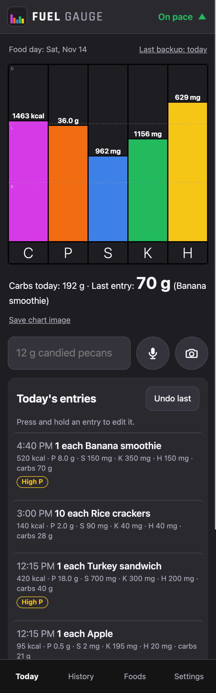</td>
<td width="33%" valign="top">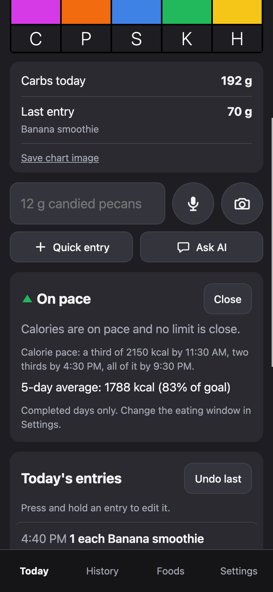</td>
<td width="33%" valign="top">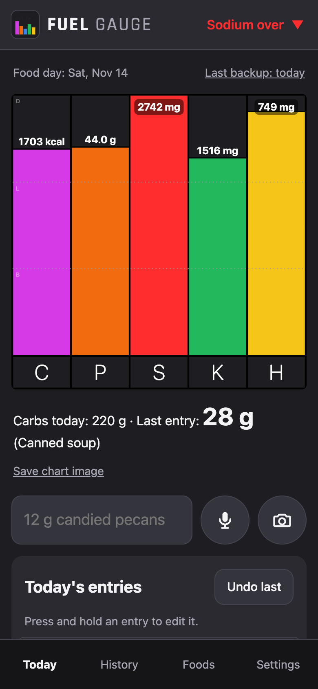</td>
</tr>
<tr>
<td valign="top"><b>Today.</b> One bar each for calories (C), protein (P), sodium (S), potassium (K) and phosphorus (H), filled against the day's targets. Below it, a card with the day's effective carbs and the last entry's. Type or dictate what you ate, photograph a label, add a Quick entry, or ask the AI.</td>
<td valign="top"><b>Trend indicator.</b> Top right: on pace (green up arrow), behind or close to a limit (yellow dash), or a limit over (red down arrow). Tap it for the reasons, the calorie pace and the weekly average.</td>
<td valign="top"><b>Red means danger.</b> Red appears only when a limit is exceeded: the bar, its label and the indicator. Nothing else in the app is red.</td>
</tr>
<tr>
<td valign="top">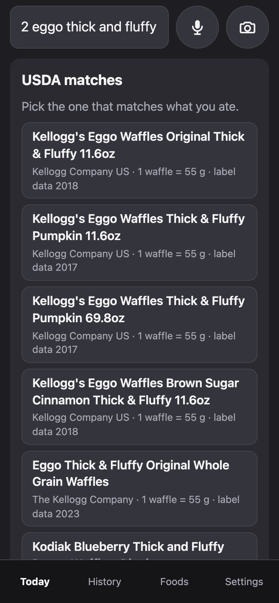</td>
<td valign="top">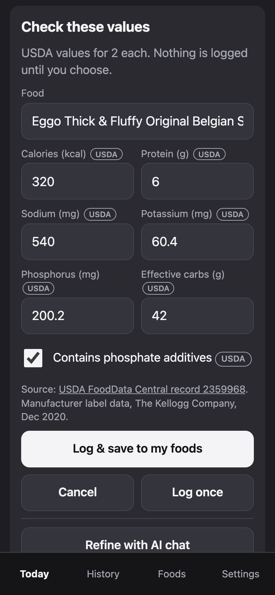</td>
<td valign="top">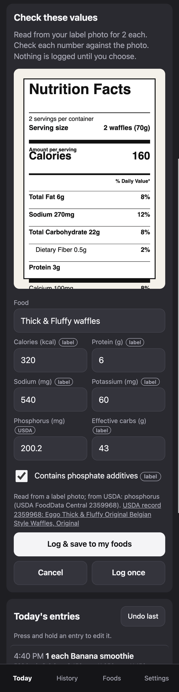</td>
</tr>
<tr>
<td valign="top"><b>USDA lookup.</b> A food the app doesn't know yet is searched in USDA FoodData Central. Pick the matching product.</td>
<td valign="top"><b>Check before saving.</b> Every value shows where it came from, and the card links to the USDA record and gives its date. Nothing is logged until you choose.</td>
<td valign="top"><b>Label photo.</b> Photograph a Nutrition Facts label and the printed values are read in. Anything the label leaves out, such as phosphorus, is filled in from USDA.</td>
</tr>
<tr>
<td valign="top">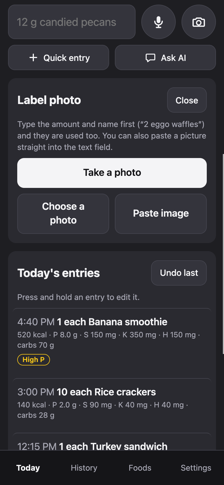</td>
<td valign="top">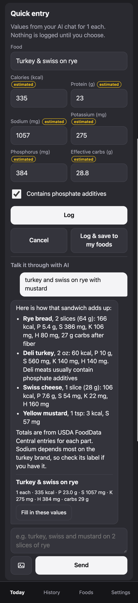</td>
<td valign="top">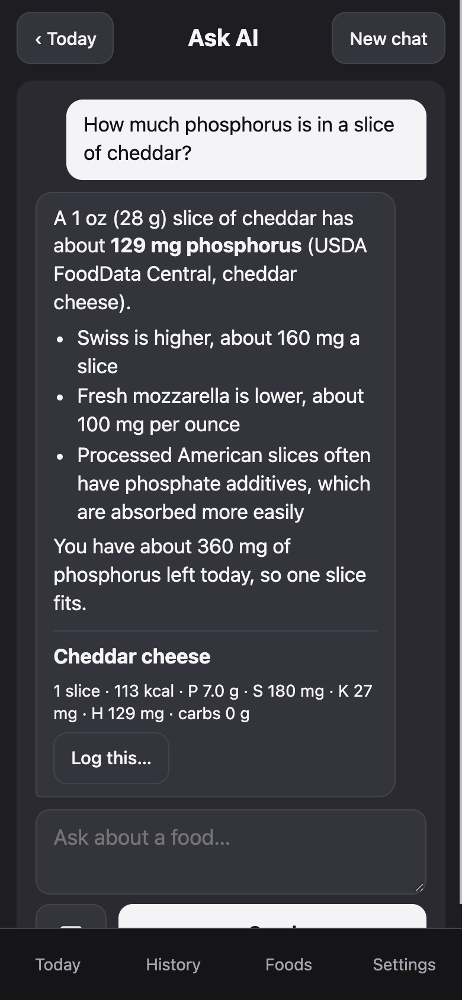</td>
</tr>
<tr>
<td valign="top"><b>Any picture.</b> Take a photo, pick one from the library, or paste one. A picture that isn't a label can be estimated with the AI instead.</td>
<td valign="top"><b>Talk it through.</b> Tell the AI what was in it. It shows each part's numbers and why, and one tap fills in the fields to check before logging. Works on any lookup and in Quick entry.</td>
<td valign="top"><b>Ask AI.</b> A chat that logs nothing: look a food up, compare two, or ask whether it fits today. An answer with numbers can be sent to Quick entry.</td>
</tr>
<tr>
<td valign="top">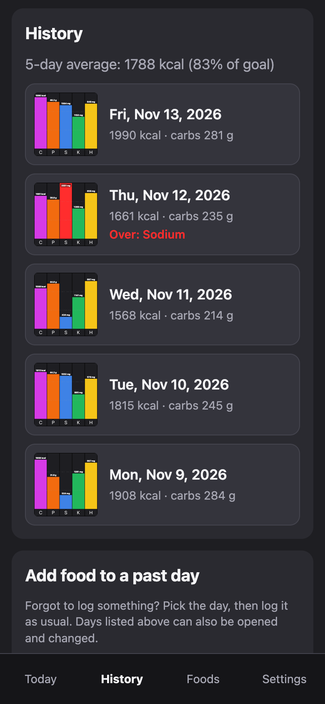</td>
<td valign="top">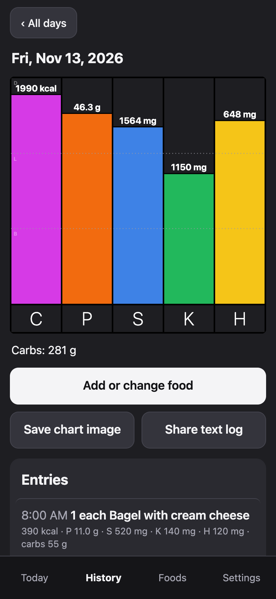</td>
<td valign="top">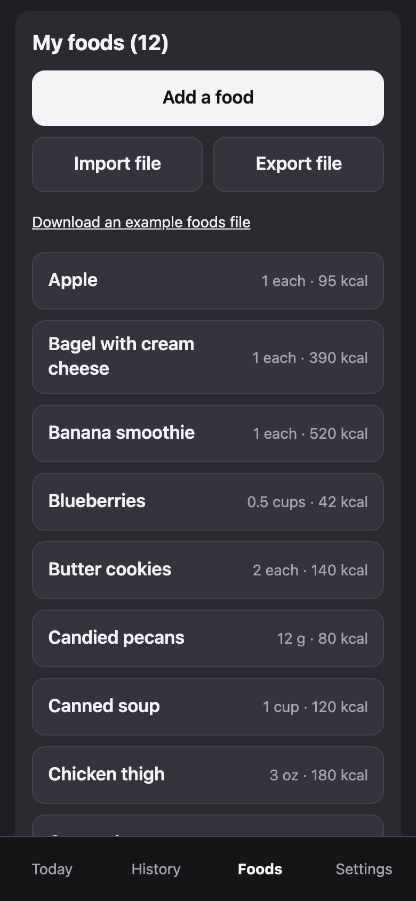</td>
</tr>
<tr>
<td valign="top"><b>History.</b> Each day is filed at 2 AM with its final chart, any limits it went over, and the weekly calorie average.</td>
<td valign="top"><b>A past day.</b> The chart and every entry, with buttons to save the chart image or share a text log. <b>Add or change food</b> opens the day to fix it.</td>
<td valign="top"><b>My foods.</b> Saved foods log instantly, with no network needed. The list imports and exports as a plain-text file.</td>
</tr>
</table>

### Features at a glance

- **Voice-first logging**: `2 slices toast`, `half a banana`, `undo`, `what's left?`
- **Five-nutrient chart**: calories as a goal; protein, sodium, potassium and phosphorus as limits; colours are configurable
- **Effective carbs**: total carbs minus fiber, reported but never turned into a dose
- **USDA FoodData Central lookup**, with the source linked
- **AI lookup** through OpenAI, Gemini, Claude or any OpenAI-compatible API; AI values are tagged *estimated* until you confirm them
- **Label photo reading** from the camera, the photo library or a pasted image, with gaps filled from USDA
- **AI chat**: talk an entry through ("turkey and swiss on rye") and have the numbers filled in, or ask about a food without logging anything
- **Quick entry** for a one-off meal: type the totals, or work them out with the AI
- **Trend indicator** paced over an eating window, plus a 7-day calorie average
- **Phosphate-additive flag** and per-entry "High P" badges
- **History**, with a chart image and text log for each day
- **Zip backup and restore**, and a plain-text foods file for editing on a computer
- **Runs on the phone itself**: offline PWA, no server, no account; data stays in the phone's storage

## Quick start

```sh
npm test         # run the unit tests (Node 20+; no packages to install)
npm run serve    # serve the app at http://localhost:8080
```

Then open <http://localhost:8080> in a browser. To put it on a phone, see
[DEPLOY.md](DEPLOY.md).

## Status

Built in phases.

- [x] **1. Scaffold**: storage, settings (targets and colors), my foods, manual logging, tests
- [x] **2. Chart**: the five-bar SVG chart, entry editing and undo, offline PWA
- [x] **3. Voice and parser**: speech and text input, fuzzy food matching, foods-file import/export
- [x] **4. AI lookup**: nutrition lookup for unknown foods, with confirm-before-save
- [x] **4b. USDA lookup**: sourced values from USDA FoodData Central, with a link to the record
- [x] **4c. Label photo**: photograph a Nutrition Facts label and have the values read into the confirm card
- [x] **5. Days and backup**: 2 AM rollover snapshots, history, zip backup and restore (done ahead of phase 4)
- [x] **6. Trend indicator**: status-row icon for calorie pace and limits, 7-day calorie average

## Layout

```
docs/               the app, served as-is by GitHub Pages (no build step)
  index.html
  sw.js             service worker: offline app shell, versioned updates
  manifest.webmanifest, icons/
  css/app.css
  js/
    app.js          app shell and tab bar
    store.js        the only module that touches IndexedDB
    chart.js        pure: renderChartSVG(totals, targets, colors) -> SVG string
    nutrients.js    pure: nutrient definitions, targets, scaling, totals
    parser.js       pure: "half a banana" -> amount + unit + food, and commands
    fuzzy.js        pure: matching a spoken name to foods and aliases
    foodsFile.js    pure: the foods text file (parse, merge/replace plan, export)
    history.js      pure: a finished day's summary record and readable text log
    backup.js       pure: backup files (entries.csv, daily_summary.csv, ...) and restore planning
    ai.js           OpenAI-compatible client, prompts, reply validation (fetch is injectable)
    chat.js         AI chat prompts and reading the values block from a reply
    usda.js         USDA FoodData Central search and record reading (fetch is injectable)
    units.js        pure: unit names and conversions
    day.js          pure: the 2 AM food-day boundary
    ui/             screens (Today, History, Foods, Settings), files, backup
  vendor/           third-party code copied in (JSZip); see vendor/README.md
tests/              node --test unit tests for the pure modules
screenshots/        README images (demo data)
tools/              readme-shots.mjs: retakes the screenshots in headless Chrome
```

## Logging

Type or dictate into the field on the Today screen and press Return:

- `log 12gm of candied pecans`, `2 slices toast`, `half a banana`, `a cup of rice`, `1.5 oz cheddar`
- `undo`, `delete the pecans`, `what's left?`

Known foods are logged instantly and never need the network. If several foods
match, the app asks which one, with **None of these** buttons that go on to USDA
and then AI. A food not in the list is searched in the same order: my foods,
then USDA (when a key is set), then AI. Press and hold an entry to edit or
delete it.

**Quick entry**, under the text field, is for a one-off meal: type the totals
(blank counts as 0) and press **Log**, or **Log & save to my foods** to keep it.
Entries typed this way have the source `me`.

## AI chat

Any AI answer on a confirm card opens with a chat under it (USDA and label cards
have a **Refine with AI chat** button, and Quick entry has **Describe it to AI
instead**). Tell it what was in the food, the brand or the size; it lists each
component with its numbers, the totals, and why it chose them. **Fill in these
values** puts the totals in the card's fields, tagged **estimated**, to check
before logging. Nothing is logged from the chat itself.

**Ask AI**, under the text field, opens a chat that logs nothing: ask about a
food, compare two, or ask whether something fits in the day (the chat is told
the day's totals and targets). An answer with values has a **Log this…** button
that opens Quick entry with them filled in.

The model ends a reply that has numbers with a fenced `values` JSON block,
which the app reads and validates (`docs/js/chat.js`). Chats can include a
photo, attached or pasted. They are not stored and are never in a backup. Like
every other AI call, a reply that strays into insulin or dosing is replaced.

## Fixing a past day

Forgot to log dinner? In **History**, open the day and tap **Add or change
food**, or use **Add food to a past day** under the list for a day with nothing
logged. Today then shows that day with a yellow **Changing …** bar: everything
logged there (typed, spoken, a label photo, Quick entry, the AI chat) goes on
that day at the time set in the bar, which starts at the end of the eating
window. Press and hold an entry to change or delete it. After each change, the
day's History record, text log and chart image are filed again. **Done** goes
back to the day in History, and the Today tab goes back to today.

## USDA lookup

An AI model answers from memory and cannot say where a number came from. With a
free [USDA FoodData Central](https://fdc.nal.usda.gov/) API key under
**Settings → USDA lookup**, a food that is not in the list is searched there
first. The app lists the matching records; picking one opens the confirm card
with:

- for packaged foods, the values printed on the manufacturer's label, per label
  serving, plus anything else the record holds (phosphorus, when the
  manufacturer reported it);
- for plain foods, USDA's own figures per 100 g;
- a link to the record, and its date, since label data can be years old.

Each value is tagged **USDA**. A value USDA does not have is never taken as 0:
if AI lookup is also set up it is estimated and tagged **estimated**, and
otherwise the field is left blank to fill in. A barcode often has several
records over the years, so the newest one is fetched. Foods saved from here have
the source `usda-confirmed` and keep the record number in their notes. Only the
food words are sent to USDA, and the key is stored and protected the same way
as the AI key.

## Label photo

The camera button on Today reads a Nutrition Facts label from a new photo, one
chosen from the photo library (or a file on a Mac), or the clipboard. Pasting a
picture into the text field, or ⌘V anywhere on Today, does the same. If the
picture isn't a label (a plate of food, say), the app offers to estimate it from
the photo in Quick entry with the AI chat. The photo is
shrunk (which also drops its metadata), sent to the configured AI provider, and
the model copies the printed values: it is told never to estimate, and to leave
anything unprinted blank. The confirm card shows the photo above the values so
each number can be checked, with every value tagged **label**. Phosphorus is
rarely on a label, so when a USDA key is set and the product has a name (typed
before the photo, or printed in it), a closely matching USDA record supplies the
missing values, tagged **USDA** with a link; otherwise they stay blank to fill
in. The photo is not stored. Foods saved this way have the source
`label-confirmed`. The model must accept images.

## AI lookup

Foods that are not in the list can be looked up through any OpenAI-compatible
Chat Completions API, called with `fetch` directly from the browser. Set the
provider, API key and model under **Settings → AI lookup**. The key is stored
only in the phone's IndexedDB; it is never logged and never written to a backup.
Only the food text that was typed or dictated is sent to the provider, plus,
in a chat, the messages and photos you send and the day's nutrient totals.

A lookup never logs anything by itself. It opens a confirm card with every
value editable and tagged "estimated"; **Log & save to my foods** stores the
food as `ai-confirmed`, and **Log once** leaves the entry marked estimated.
If the AI can't be reached, the app says so and offers manual entry. Logging
known foods never uses the network.

Presets, each checked for browser (CORS) access on 2026-11-14:

| Preset | Base URL | Note |
|---|---|---|
| OpenAI | `https://api.openai.com/v1` | |
| Google Gemini | `https://generativelanguage.googleapis.com/v1beta/openai` | |
| Anthropic Claude | `https://api.anthropic.com/v1` | The app adds the `anthropic-dangerous-direct-browser-access: true` header, which this endpoint requires from browsers. Anthropic describes this compatibility layer as meant for testing rather than production. |
| Custom | any `https://` OpenAI-compatible address | Must allow browser requests from the app's origin. |

Requests send only `model` and `messages` (JSON is asked for in the prompt and
validated in the app, with one retry), because providers disagree on fields
such as `response_format`.

## Trend indicator

A small icon at the top of Today, with a few words beside it:

| Icon | Meaning |
|---|---|
| Green up arrow | Calories (and the protein minimum, if set) on pace; no limit close |
| Yellow dash | Behind on calories or the protein minimum, or a limit at 85% of its target, or at 50% before the first checkpoint |
| Red down arrow | A limit exceeded. Red is used for nothing else. |
| Grey dot | Nothing logged yet today |

Pace uses the eating window from Settings (default 6:30 AM to 9:30 PM), split
in thirds: a third of the calorie goal is expected by 11:30 AM, two thirds by
4:30 PM, all of it by 9:30 PM. Between checkpoints only the last one passed
counts, which leaves room to catch up later in the day. Going over the calorie
goal is never a problem. Tapping the icon lists the reasons and the 7-day
calorie average (completed days only), which History also shows.

## Days, history and backup

The food day rolls over at 2:00 AM. There is no background process, so past
days are filed the next time the app is opened: each gets a stored summary, a
readable text log and a PNG of its final chart. The History screen lists them.

**Settings → Backup** builds one zip (entries.csv, daily_summary.csv, a PNG and
text log per finished day, my-foods.txt, and settings.json with no API key) and
hands it to the share sheet. It can also export a date range, and restore from
a backup zip; restoring only adds what is missing.

## The foods file

Foods import and export as a plain-text CSV, so the list can be edited on a
computer and moved to the phone through Files or iCloud Drive.
[docs/example-foods.txt](docs/example-foods.txt) has the header and the column
notes. Import previews its changes ("12 new, 3 updated, 1 line skipped") and
offers Merge or Replace all before anything is saved.

## Rules this code follows

- Plain HTML, CSS and vanilla ES modules. No build step, no runtime dependencies.
- No scripts from CDNs. A Content-Security-Policy allows scripts only from the app's own origin.
- Red (`#FF2D2D`) means danger (a limit exceeded) and is used for nothing else.
- Nothing is hard-deleted. Deleted entries and foods are flagged and left in storage.
- No personal data or API keys in this repo.
